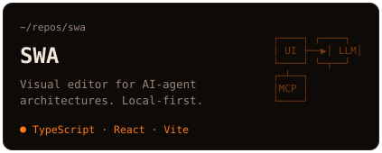
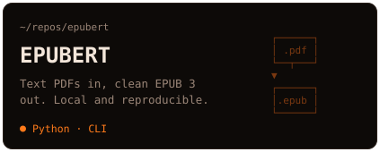
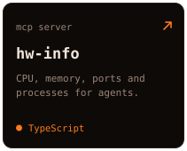
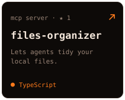
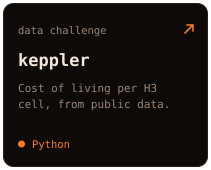
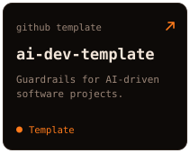

<!-- The images in assets/ are generated. Hero and tiles: edit scripts/build.mjs and run `node scripts/build.mjs`. Activity: scripts/activity.mjs, refreshed daily by .github/workflows/activity.yml. -->

<a href="https://argta.netlify.app/">argta.netlify.app</a> &nbsp;·&nbsp; <a href="https://www.linkedin.com/in/tobias-arangio/">LinkedIn</a>

